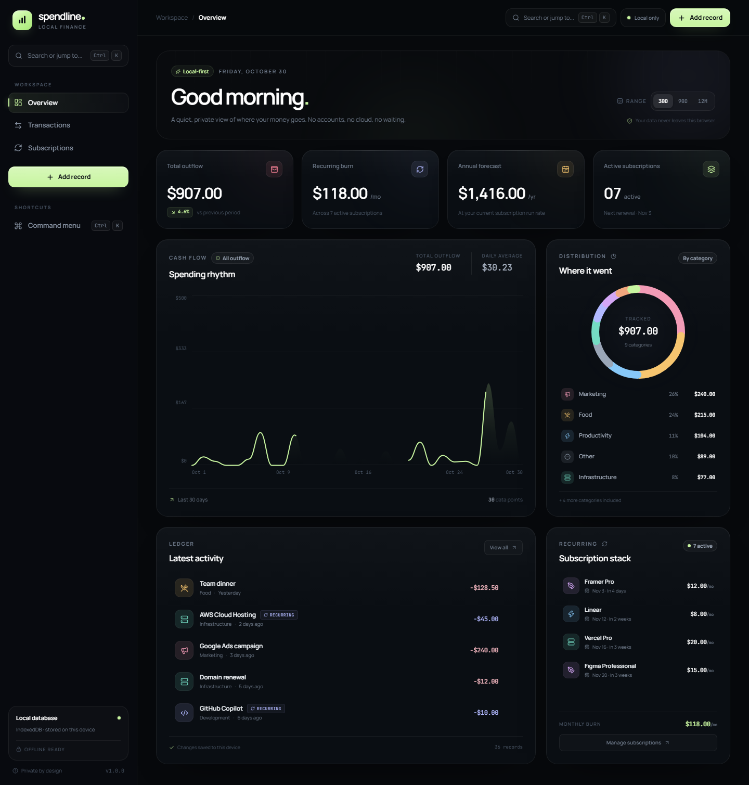
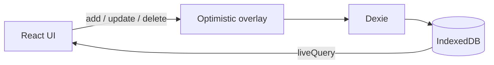

# Spendline

**A private, local-first subscription and expense analytics dashboard.**

Spendline is a portfolio project built to explore what a finance app feels like when the network is removed from the critical path. Every record lives in the browser's IndexedDB, every calculation runs in client memory, and every mutation appears instantly. There is no backend, no account, and no financial data leaving the device.



## Highlights

- **Local-first by design** — subscriptions and expenses are persisted in IndexedDB through Dexie.js.
- **Instant optimistic UI** — adds, deletes, pause/resume, and undo update the interface before persistence finishes, with automatic rollback on failure.
- **Client-side analytics** — monthly recurring burn, annual forecast, category distribution, period-over-period change, daily average, and renewal radar.
- **Keyboard-first workflow** — `Cmd/Ctrl + K` opens a command palette for adding records, switching views, filtering the ledger, searching records, and exporting a backup.
- **Offline-ready PWA** — a production service worker caches the app shell, CSS, JavaScript, fonts, and icons; the app remains usable without a connection.
- **Responsive, dark, and deliberate** — desktop sidebar, mobile bottom navigation, accessible dialogs, focus management, and reduced-motion support.

## Feature tour

### Overview

The landing view combines a greeting, the selected analytics range, four headline metrics, an interactive spend chart, a category donut, recent activity, and the active subscription stack.

- Switch between **30 days**, **90 days**, and **12 months**.
- Hover or drag across the spend chart to inspect individual buckets.
- Compare current outflow against the previous equivalent period.
- See the next renewal and the number of active subscriptions at a glance.

### Transactions

The ledger is searchable and filterable entirely in memory.

- Search by title, category, or record type.
- Filter by **expenses**, **subscriptions**, or **all records**.
- Filter by category.
- View records grouped by date with daily totals.
- Export the full dataset as a JSON backup.
- Delete a record and undo the deletion from the toast.

### Subscriptions

Recurring costs are treated as first-class records.

- Monthly burn normalizes yearly plans to a monthly equivalent.
- Annual commitment is projected from the current run rate.
- Active and paused subscriptions are separated.
- Pause or resume a plan without deleting its history.
- Renewal radar shows the next charges in chronological order.
- Recurring mix breaks monthly burn down by category.

### Command palette

Press `Cmd/Ctrl + K` anywhere in the app.

- Add an expense or subscription.
- Jump to Overview, Transactions, or Subscriptions.
- Filter the ledger by record type.
- Search local records by title, category, or billing cycle.
- Export a JSON backup.

The palette supports arrow-key navigation, `Enter` to run, `Esc` to close, and restores focus to the previously active element when dismissed.

## Tech stack

| Layer | Choice |
| --- | --- |
| Framework | React 19 |
| Build tool | Vite 8 |
| Styling | Tailwind CSS v4 with `@tailwindcss/vite` |
| Local database | Dexie.js + `dexie-react-hooks` |
| Icons | `lucide-react` |
| Fonts | Self-hosted Manrope and JetBrains Mono via Fontsource |
| Offline | Custom service worker + web app manifest |
| Linting | Oxlint |

No charting or state-management library is used. The spend chart is a hand-built SVG, and all derived analytics are pure functions over the in-memory dataset.

## Architecture



The important loop is the optimistic overlay. A mutation is applied to local React state immediately, then written to Dexie. When the live query emits the persisted row, the overlay retires itself. If the write fails, the overlay is removed and the UI rolls back. Deletes use the same idea with a temporary hidden-ID set, which makes undo possible.

### Why this shape?

- **Reads** are handled by `useLiveQuery`, so any tab or component reading the database stays in sync automatically.
- **Writes** go through a small hook (`useTransactions`) that owns optimistic state and rollback behavior.
- **Calculations** live in `src/lib/analytics.js` as pure functions, which keeps the components focused on rendering.
- **Dates** live in `src/lib/dates.js`, including month-safe renewal logic that handles year boundaries and short months.

### Data model

Dexie schema:

```js
db.version(1).stores({
  transactions: '++id, clientId, title, category, type, date, billingCycle',
})
```

Record shape:

```ts
{
  id: number
  clientId: string
  title: string
  amount: number
  category: string
  type: 'expense' | 'subscription'
  date: string            // YYYY-MM-DD
  billingCycle?: 'monthly' | 'yearly'
  active?: boolean
  createdAt: string
}
```

Yearly subscriptions are stored at their actual annual price. Analytics normalize them with `amount / 12` when calculating monthly burn.

### Project structure

```text
src/
  components/
    AddRecordModal.jsx      Accessible add-record dialog
    CategoryBreakdown.jsx   SVG donut + category legend
    CommandPalette.jsx      Cmd/Ctrl+K palette and record search
    MobileNav.jsx           Bottom navigation for small screens
    Overview.jsx            Dashboard composition
    Sidebar.jsx             Desktop navigation
    SpendChart.jsx          Interactive SVG spend chart
    SubscriptionCard.jsx    Subscription actions and status
    SubscriptionsView.jsx   Recurring-cost workspace
    TransactionsView.jsx    Searchable, filterable ledger
    ...
  data/
    categories.js           Category definitions and colors
  hooks/
    useTransactions.js      Dexie live query + optimistic overlay
    useToasts.js            Toast queue and timers
    useOnlineStatus.js      Online/offline indicator
  lib/
    analytics.js            Pure metrics and aggregation functions
    dates.js                Date, range, and renewal helpers
    format.js               Currency, number, and percent formatting
  App.jsx                   Navigation, CRUD handlers, shortcuts, layout
  db.js                     Dexie schema, seed data, demo reset
  index.css                 Tailwind theme and component styles
public/
  manifest.webmanifest      PWA metadata
  sw.js                     App-shell and runtime caching
tests/
  analytics.test.js         Analytics and filtering checks
  dates.test.js             Date, renewal, and range checks
```

## Getting started

### Requirements

- Node.js 20.19+ (or 22.12+)
- npm 10+

### Install and run

```bash
npm install
npm run dev
```

Open the URL printed by Vite, usually `http://localhost:5173`.

The first run seeds 36 demo records: 7 subscriptions and 29 expenses. Delete them at any time; the app continues to work with an empty ledger.

### Production build

```bash
npm run build
npm run preview
```

The production build is written to `dist/`.

### Scripts

| Command | Purpose |
| --- | --- |
| `npm run dev` | Start the Vite dev server |
| `npm run build` | Build for production |
| `npm run preview` | Serve the production build locally |
| `npm run lint` | Run Oxlint |
| `npm test` | Run the date and analytics unit tests |

### Tests

`npm test` runs the built-in Node test runner over the pure helpers in `src/lib/`:

- `tests/dates.test.js` covers ISO date parsing, month clamping, renewal fast-forwarding, leap years, period windows, and relative labels.
- `tests/analytics.test.js` covers monthly normalization, subscription sorting, category totals, spend buckets, period-over-period comparisons, filtering, and date grouping.

The UI itself is verified against the production build (add, pause/resume, delete/undo, filtering, keyboard palette, focus return, and IndexedDB persistence).

## Offline behavior

The service worker is registered only in production builds. To test offline support:

1. Run `npm run build`.
2. Run `npm run preview`.
3. Open the preview URL and let the first load finish.
4. Switch DevTools to **Offline** and reload.

The app shell, bundled assets, fonts, and icons are served from the cache. Financial records remain available because they live in IndexedDB, not in the service worker cache.

## Deployment

Spendline is a static Vite app and deploys without a backend.

### Vercel

- Framework preset: **Vite**
- Build command: `npm run build`
- Output directory: `dist`

`vercel.json` is included with those settings plus cache headers: hashed assets are immutable, while `index.html` and `sw.js` stay revalidating so deployments and service-worker updates are picked up promptly.

### Netlify

- Build command: `npm run build`
- Publish directory: `dist`

`netlify.toml` is included with the same build settings and cache headers.

No environment variables are required.

## Privacy

- Financial records are stored in IndexedDB under the `spendline-local` database.
- The app makes no API calls for user data.
- Fonts are self-hosted, so typography does not depend on a third-party CDN.
- The JSON backup is generated locally with `Blob` and downloaded directly from the browser.
- Clearing site data for the origin removes the local database, so users should export a backup before clearing browser storage.

## Verification checklist

- [x] Production build passes.
- [x] Oxlint passes with no warnings.
- [x] `npm test` passes (19 date and analytics tests).
- [x] Add expense and subscription flows persist to IndexedDB.
- [x] Yearly subscriptions normalize to the correct monthly burn.
- [x] Delete + undo restores the record.
- [x] Pause/resume updates the burn rate immediately.
- [x] Command palette opens with `Cmd/Ctrl+K`, focuses its input, searches records, runs actions with the keyboard, and returns focus when closed.
- [x] Add-record dialog traps focus, returns focus on close, and keeps the form open if persistence fails.
- [x] Desktop and mobile layouts render correctly.
- [x] Service worker caches the production app shell for offline use.

## Resume bullet points

- Built **Spendline**, a local-first subscription and expense analytics dashboard using **React 19, Vite, Tailwind CSS v4, and Dexie/IndexedDB**, delivering instant CRUD with zero backend infrastructure.
- Designed an **optimistic UI layer** over Dexie live queries with rollback, temporary hidden IDs, and undo, keeping interactions responsive while persistence happens in the background.
- Implemented **client-side analytics** for monthly recurring burn, annual forecast, category distribution, period-over-period trends, daily averages, and renewal scheduling.
- Added a **keyboard-first command palette** (`Cmd/Ctrl+K`) with instant record search, view switching, filters, and backup export, including focus restoration and ARIA dialog semantics.
- Shipped an **installable PWA** with a custom service worker that precaches the app shell, fonts, and icons for offline use, plus a responsive desktop/mobile navigation system.

## Possible next steps

- Import a previously exported JSON backup with schema validation.
- Add budget targets and per-category alerts.
- Support multi-currency records with historical conversion snapshots.
- Add a calendar heatmap for daily outflow.
- Introduce optional encrypted export/import for moving data between devices.

## License

[MIT](LICENSE)
