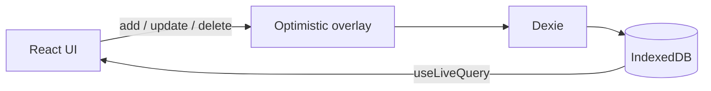

# Spendline

A private, local-first subscription and expense dashboard. Every record lives in the browser's
IndexedDB, every calculation runs in client memory, and every mutation appears instantly.

**Live app:** https://sklevel8-spendline.netlify.app
**Stack:** React 19 · Vite · Tailwind CSS v4 · Dexie (IndexedDB) · service worker PWA

---

## Why this exists

Almost every budgeting app asks you to upload your transactions before it will show you a number.
That trade is rarely examined: the value is a chart of your own data, and the cost is that a third
party now holds a detailed record of where you live, what you earn, and who you pay.

Spendline was built to test the opposite arrangement. If the data never leaves the device, what do
you lose? The answer turns out to be very little — and what you gain is a different set of
engineering problems that are more interesting than the CRUD it replaces:

- persistence has to be **fast and durable in the browser**, not just a cache;
- the interface has to assume the write may fail, because it is applied before the write;
- the app has to work with no network at all, which means the *shell* is part of the product;
- analytics have to be recomputed locally, so they must be cheap, pure and testable.

"Local-first" here is not a slogan for a degraded offline mode. The network is not on the critical
path at any point, because there is no network.

## How it works



**Reads.** Components subscribe with `useLiveQuery`, so any view, and any other tab, stays in sync
with the database automatically. There is no store to invalidate and no cache to bust.

**Writes.** A mutation is applied to local React state *first*, then handed to Dexie. When the live
query emits the persisted row, the overlay retires itself. If the write throws, the overlay is
removed and the UI rolls back — the optimistic layer is a small, explicit state machine in
`useTransactions`, not a library flag.

**Deletes** work the same way with a temporary hidden-ID set, which is what makes undo possible: the
row is hidden immediately, and only removed from the database after the toast expires.

**Analytics** are pure functions in `src/lib/analytics.js` over the in-memory dataset: monthly
recurring burn (annual plans normalised to `amount / 12`), annual forecast, category distribution,
period-over-period change, daily average, and the renewal radar. Pure functions mean the numbers are
unit-testable without a browser, which is exactly what `tests/analytics.test.js` does.

**Renewals** live in `src/lib/dates.js` and deliberately do not use naive month arithmetic.
Advancing 31 January by one month has a right answer, and short months, leap years and year
boundaries all have to agree with it.

### Data model

```js
db.version(1).stores({
  transactions: '++id, clientId, title, category, type, date, billingCycle',
})
```

```ts
{
  id: number
  clientId: string
  title: string
  amount: number
  category: string
  type: 'expense' | 'subscription'
  date: string            // YYYY-MM-DD
  billingCycle?: 'monthly' | 'yearly'
  active?: boolean
  createdAt: string
}
```

Amounts are stored as the amount the user actually pays. Normalisation to a monthly figure happens
at analysis time, so the stored data keeps its real shape.

## Features

- **Local-first persistence** through Dexie, with seed data for a first-run demo and a reset action.
- **Instant optimistic UI** with automatic rollback on failure, and undo for deletes.
- **Client-side analytics**: monthly burn, annual forecast, category mix, period comparison, daily
  average, renewal radar.
- **Interactive SVG spend chart** — hand-built, no charting library; hover or drag to inspect
  buckets.
- **Command palette** (`Cmd/Ctrl + K`) for adding records, switching views, filtering the ledger,
  searching, and exporting a JSON backup.
- **Offline PWA**: a service worker caches the shell, CSS, JS, fonts and icons.
- **Accessible by construction**: real dialogs with focus management, visible focus, keyboard paths,
  reduced-motion support, mobile bottom navigation.

## Run it locally

Requirements: Node.js 20.19+.

```bash
npm install
npm run dev        # http://localhost:5173
npm run build      # production bundle in dist/
npm run preview    # serve the built app
```

| Script | Purpose |
| --- | --- |
| `npm run dev` | Vite dev server |
| `npm run build` | Production build (also emits the service worker assets) |
| `npm run preview` | Preview the built output |
| `npm run lint` | Oxlint |
| `npm test` | Analytics and date unit tests (`node --test`) |

## Tests

`tests/analytics.test.js` and `tests/dates.test.js` cover the two places where a quiet bug would be
most damaging: money aggregation and renewal arithmetic. Both suites run under `node --test` with no
browser, because both modules are pure.

## Project layout

```
src/
  components/     Overview, Transactions, Subscriptions, dialogs, chart, palette
  hooks/          useTransactions (live query + optimistic overlay), toasts, online status
  lib/            analytics.js, dates.js, format.js
  data/           category definitions and colours
  db.js           Dexie schema, seed data, demo reset
  index.css       Tailwind theme and component styles
public/           manifest, icons, service worker
tests/            analytics and date suites
```

## Deployment

`netlify.toml` runs `npm run build` and publishes `dist/`, with immutable caching for `/assets/*`
and `no-cache` for the service worker and `index.html`. The app is static — there is no server
component to deploy, which is the point.

## Licence

MIT
